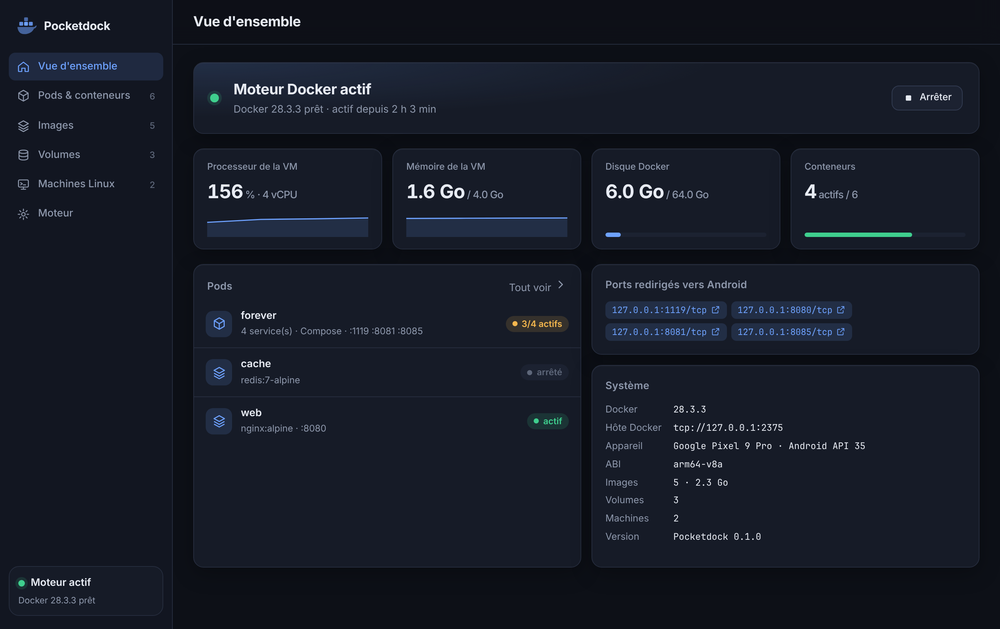
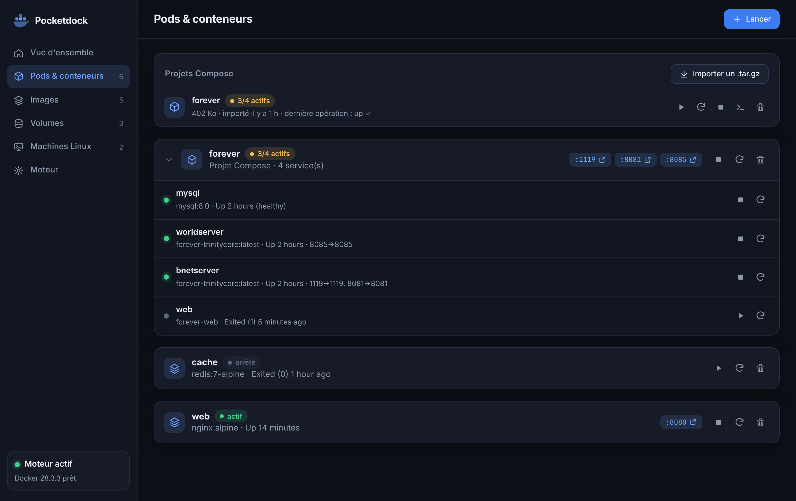
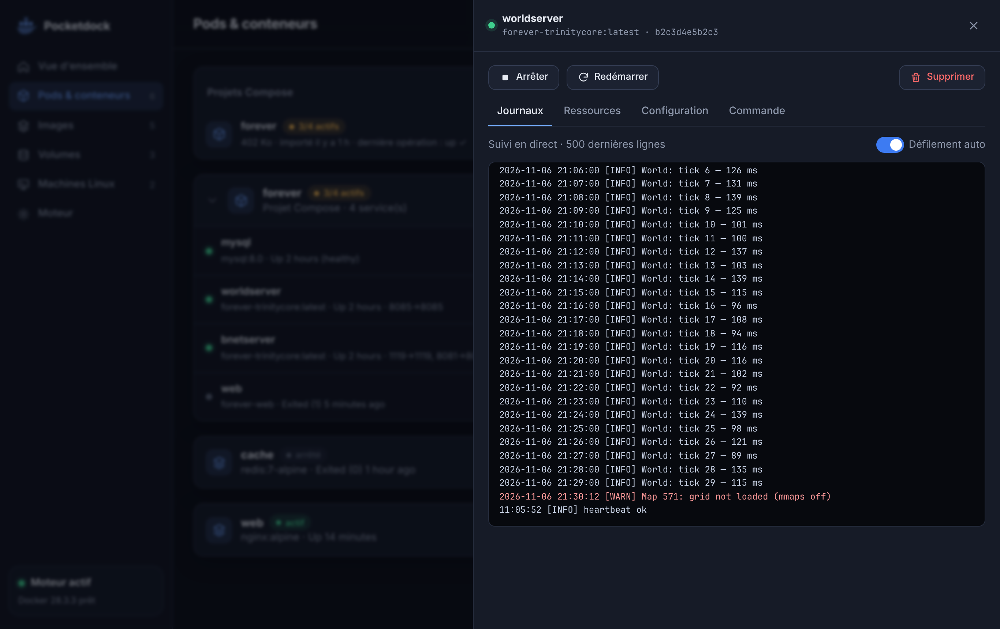
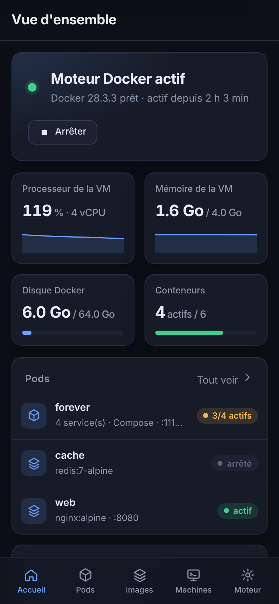

# Pocketdock

<a href="https://claude.ai"></a>

**Docker et Linux dans la poche.** Pocketdock fait tourner des conteneurs Docker, des projets
Docker Compose et des machines Linux sur un téléphone Android, dans une seule application, **sans
root**. L'idée vient d'[OrbStack](https://orbstack.dev) sur macOS : installer, appuyer sur
« Démarrer », et `docker run` fonctionne.



| Pods (projet Compose déplié) | Journaux en direct | Sur téléphone |
|---|---|---|
|  |  |  |

> **État du projet : préversion (0.1).** La chaîne complète (VM, Docker, Compose, machines, tableau
> de bord) est testée automatiquement sur un émulateur Android x86_64. **Elle n'a pas encore été
> validée sur un vrai téléphone arm64.** Attendez-vous à des lenteurs (voir [Performances](#performances))
> et à des angles vifs.

---

## Sommaire

- [Ce que fait Pocketdock](#ce-que-fait-pocketdock)
- [Installation](#installation)
- [Premiers pas](#premiers-pas)
- [Docker Compose](#docker-compose)
- [Machines Linux](#machines-linux)
- [Tableau de bord web et API de pilotage](#tableau-de-bord-web-et-api-de-pilotage)
- [Comment ça marche](#comment-ça-marche)
- [Performances](#performances)
- [Compiler](#compiler)
- [Tests et CI](#tests-et-ci)
- [Dépannage](#dépannage)
- [Limites connues](#limites-connues)
- [Feuille de route](#feuille-de-route)
- [Structure du dépôt](#structure-du-dépôt)
- [Licence](#licence)

---

## Ce que fait Pocketdock

| | OrbStack (macOS) | Pocketdock (Android) |
|---|---|---|
| Moteur Docker | VM Linux légère (Virtualization.framework) | VM Alpine légère exécutée par **QEMU** |
| Docker Compose | oui | oui, exécuté **dans** la VM (bind mounts, `build:`, `.env`) |
| Ports | redirection automatique vers `localhost` | redirection automatique vers `127.0.0.1` (ou le réseau local) |
| Machines Linux | VM partageant le noyau | rootfs exécutés par **proot** (démarrage instantané) |
| CLI | `docker`, `orb` | client `docker` officiel intégré au terminal et à chaque machine |
| Interface | app native | app Android + **tableau de bord web** (téléphone ou PC) |
| Automatisation | CLI | **API HTTP locale** à jeton |

Fonctionnalités principales :

- **Moteur Docker** (Docker 28) dans une VM Alpine Linux arm64, démarrée en arrière-plan par un
  service de premier plan, avec un disque de données persistant (fichier creux, 16 à 256 Go).
- **Stacks et conteneurs** : les projets Compose ont leur entrée **Stacks**, les conteneurs isolés
  l'entrée **Conteneurs**. On peut les démarrer, arrêter, redémarrer ou supprimer d'un geste, ouvrir leurs ports, suivre les journaux
  en direct (stderr en rouge), voir CPU, mémoire, réseau et processus, lire la configuration (secrets
  masqués), exécuter une commande ou ouvrir un terminal.
- **Images et volumes** : téléchargement, lancement, suppression, nettoyage.
- **Stacks Compose** : import d'un dossier (`.tar.gz`) avec « Importer et démarrer », `up`,
  `up --build`, `down`, sortie en direct.
  Les healthchecks sont adaptés automatiquement à la lenteur de la VM émulée.
- **Redirection automatique des ports** : `docker run -p 8080:80 nginx` est servi sur
  `http://127.0.0.1:8080` dans le navigateur du téléphone, y compris les ports publiés sur
  `127.0.0.1` dans un fichier Compose.
- **Machines Linux** (Alpine 3.22, Ubuntu 24.04, ou n'importe quel rootfs) avec un vrai terminal
  (émulateur de Termux) et `docker` préconfiguré.
- **Terminal Docker** : shell Android avec le client `docker` officiel.
- **API de contrôle** sur `http://127.0.0.1:7777/v1`, protégée par jeton, qui pilote tout ce qui
  précède : scripts, agents, tests automatisés.
- Réglages : processeurs, mémoire, disque, exposition sur le réseau local, démarrage automatique,
  maintien du processeur éveillé, console série de la VM.

## Installation

### Prérequis

- Téléphone ou tablette **arm64** (`arm64-v8a`), **Android 8.0** ou plus récent. Un émulateur
  x86_64 fonctionne aussi (APK multi-ABI).
- **4 Go de RAM** conseillés : la VM en réserve 2 Go par défaut (réglable).
- **3 Go d'espace libre** au minimum, plus la place de vos images Docker.
- Une connexion Internet au premier démarrage : téléchargement du noyau Alpine, puis installation
  de Docker dans la VM.

### Télécharger l'APK

Aucune version n'est encore publiée sur un store. L'APK est produit par la CI à chaque push :

1. Ouvrir l'onglet **Actions** du dépôt, puis le dernier run **Build APK** réussi.
2. Télécharger l'artefact **pocketdock-apk** (zip contenant `pocketdock-debug.apk` et `pocketdock-release.apk`).
3. Sur le téléphone, autoriser l'installation d'applications de cette source, puis ouvrir l'APK.

Ou par adb : `adb install -r pocketdock-debug.apk`.

> Les APK de la CI sont signés avec une clé de debug fixe (`app/debug.keystore`), ce qui permet
> d'installer une nouvelle version par-dessus l'ancienne. Le build `release` est pour l'instant signé
> avec cette même clé. Le build **debug** active l'API
> de contrôle par défaut, le build release la désactive.

## Premiers pas

1. Ouvrir **Pocketdock** et accepter les notifications (le moteur tourne dans un service de premier
   plan, visible dans la barre de notifications).
2. Appuyer sur **Démarrer** (barre du haut ou onglet **Moteur**). Au **premier démarrage**,
   Pocketdock télécharge le noyau Alpine, démarre la VM, formate le disque de données et installe
   Docker. Comptez **5 à 15 minutes** selon le téléphone et la connexion. Les démarrages suivants sont
   plus courts.
3. Quand le moteur affiche **« Docker 28.x prêt »**, ouvrez l'onglet **Moteur → Terminal** et
   essayez :

   ```sh
   docker run --rm hello-world
   docker run -d --name web -p 8080:80 nginx:alpine
   ```

   puis ouvrez `http://127.0.0.1:8080` dans le navigateur du téléphone, ou touchez le port
   `:8080` dans le tableau de bord.
4. L'icône **Tableau de bord** de la barre du haut ouvre l'interface web complète (pods, journaux,
   ressources).

Pour un premier projet Compose prêt à importer, voir [`docs/examples`](docs/examples/README.md)
(nginx + whoami + redis).

Images : seules les images disponibles pour **linux/arm64** fonctionnent, comme sur un Mac Apple
Silicon. La plupart des images officielles le sont (`nginx`, `postgres`, `redis`, `mysql`, `python`…).

## Docker Compose

Un projet Compose est un dossier contenant un `docker-compose.yml` (ou `compose.yaml`), éventuellement
un `.env`, des fichiers montés et des contextes de build. Pocketdock l'exécute **dans la VM** : les
chemins relatifs (`./data:/data`), `build:` et `.env` se comportent comme sur un poste Linux.

**Depuis le tableau de bord** : **Stacks** → **Importer un .tar.gz** → **Importer et démarrer**.

```sh
# sur votre PC : archiver le CONTENU du dossier du projet
tar czf mon-projet.tar.gz -C mon-projet .
```

Ensuite : ▶ `up -d`, ⟳ `up -d --build`, ■ `down`, et l'icône terminal pour suivre la sortie.

**Par l'API** (depuis un PC, voir plus bas pour `adb forward` et le jeton) :

```sh
curl -X PUT  -H "Authorization: Bearer $TOKEN" --data-binary @mon-projet.tar.gz \
     http://127.0.0.1:7777/v1/compose/mon-projet
curl -X POST -H "Authorization: Bearer $TOKEN" -d '{"build":true}' \
     http://127.0.0.1:7777/v1/compose/mon-projet/up          # renvoie une tâche
curl -H "Authorization: Bearer $TOKEN" http://127.0.0.1:7777/v1/jobs/job-1
```

**Healthchecks et émulation.** Les healthchecks sont écrits pour des machines natives. Sous émulation,
MySQL met par exemple 10 à 15 minutes à initialiser sa base, et serait déclaré `unhealthy` bien avant.
Avant `up`, Pocketdock récupère donc la configuration résolue par Compose et porte à 30 minutes au
moins le délai de grâce (`start_period`) des services qui ont un healthcheck. Un service sain reste
déclaré sain dès son premier test réussi. Votre `docker-compose.yml` n'est pas modifié (le fichier
adapté s'appelle `.androdock-compose.json`). Pour désactiver : `{"adaptHealthchecks": false}`.

Un exemple complet, le serveur [forever_docker](https://github.com/luraku/forever_docker) (MySQL +
site FastAPI + serveurs TrinityCore), est décrit dans [docs/forever](docs/forever/README.md).

## Machines Linux

Onglet **Machines** → **+** : choisir Alpine 3.22, Ubuntu 24.04, ou donner l'URL `https://` d'un
rootfs `.tar.gz` / `.tar.xz` pour l'architecture du téléphone.

- La machine démarre instantanément : c'est un rootfs exécuté par **proot**, pas une VM. Elle
  partage le noyau Android.
- Vous y êtes root (simulé), `apt` / `apk` fonctionnent.
- `docker` est disponible et `DOCKER_HOST` pointe vers le moteur : `docker ps` dans la machine voit
  les conteneurs de la VM.
- Le stockage partagé du téléphone est monté sur `/mnt/sdcard` si l'application y a accès.

Limites : pas de systemd ni de services en arrière-plan, et certains appels système non pris en
charge par proot échouent.

## Tableau de bord web et API de pilotage

### Tableau de bord

Servi par l'application sur `http://127.0.0.1:7777/` et affiché dans l'app par l'icône **Tableau de
bord**. Il fonctionne sans Internet, en thème sombre ou clair, sur téléphone ou sur PC :

```sh
adb forward tcp:7777 tcp:7777
TOKEN=$(adb shell run-as dev.androdock cat files/control/token)   # build debug
# puis ouvrir dans le navigateur du PC :
echo "http://127.0.0.1:7777/#token=$TOKEN"
```

Sur un build release, copiez le jeton depuis l'onglet **Moteur → API de contrôle → Copier**.

### API

Toutes les routes sauf `/v1/health` exigent `Authorization: Bearer <jeton>`. Quelques exemples :

```sh
API=http://127.0.0.1:7777/v1; H="Authorization: Bearer $TOKEN"
curl -H "$H" $API/status                                   # état complet
curl -H "$H" -X POST $API/engine/start                     # démarrer la VM
curl -H "$H" $API/docker/containers/json?all=1             # relais vers l'API Docker Engine
curl -H "$H" -X POST -d '{"cmd":"docker ps"}' $API/exec    # commande avec le client docker
curl -H "$H" -X POST -d '{"name":"dev","distro":"ubuntu"}' $API/machines
curl -H "$H" -X POST -d '{"cmd":"cat /etc/os-release"}' $API/machines/dev/exec
```

Référence complète : **[docs/control-api.md](docs/control-api.md)**.

L'API Docker Engine de la VM est aussi joignable directement sur `tcp://127.0.0.1:2375` depuis
l'appareil (Termux, autres apps) : `DOCKER_HOST=tcp://127.0.0.1:2375 docker ps`.

## Comment ça marche

```
┌──────────────────────────── APK Pocketdock ─────────────────────────────┐
│ UI Compose (onglets)        Tableau de bord web (WebView / navigateur PC)│
│        │                                │                                │
│        └──────────── API de contrôle 127.0.0.1:7777 (jeton) ─────────────┤
│                                 │                                        │
│ EngineService (premier plan)    │ ComposeManager ── conteneur utilitaire │
│   └─ DockerVm ── qemu-system-aarch64 (TCG) ─── VM Alpine 3.22 arm64      │
│        │            ├─ -kernel/-initrd netboot Alpine                    │
│        │            ├─ /dev/vda : data.img (ext4) → /var/lib/docker      │
│        │            └─ réseau slirp, hostfwd 127.0.0.1:2375 → dockerd    │
│        ├─ MiniHttpServer → overlay apkovl + modloop pour l'init Alpine   │
│        └─ PortForwarder → moniteur QEMU (hostfwd_add / hostfwd_remove)   │
│                                                                          │
│ MachineManager ── proot -0 --link2symlink -r rootfs                      │
│ TerminalActivity ── terminal-view de Termux (PTY)                        │
└──────────────────────────────────────────────────────────────────────────┘
```

**Pourquoi une VM ?** Docker a besoin d'un noyau Linux avec namespaces, cgroups et overlayfs, et des
droits root. Une application Android n'a rien de tout cela. Pocketdock démarre donc un vrai noyau
Linux dans QEMU. Sans root, une application n'a pas accès à KVM : **QEMU émule le processeur**
(TCG, multithread). Cela fonctionne partout, mais lentement.

**Démarrage de la VM.**

1. Téléchargement du noyau `vmlinuz-virt`, d'`initramfs-virt` et de `modloop-virt` d'Alpine
   (netboot), une seule fois.
2. Génération d'un **overlay Alpine** (`apkovl`, voir `vm/ApkOverlay.kt`) : paquets (`docker`,
   `docker-cli-compose`, `docker-cli-buildx`…), services OpenRC, IP statique et DNS publics,
   montage du disque de données, redirection des ports locaux, extinction propre via acpid.
3. QEMU démarre le noyau. L'init Alpine récupère l'overlay et le modloop auprès d'un mini serveur
   HTTP de l'application (`10.0.2.2` vu de la VM), installe les paquets et lance dockerd.
4. L'application attend que `GET /_ping` réponde, puis passe à « prêt ».

**Ports.** Un `PortForwarder` lit les ports publiés des conteneurs toutes les 3 s et ajoute ou retire
les redirections QEMU (`hostfwd_add`). Dans la VM, une règle `iptables` (DNAT vers `127.0.0.1`,
`route_localnet`) rend aussi joignables les ports publiés sur `127.0.0.1`.

**Compose.** Le projet est déposé sur le disque de la VM (`/mnt/data/projects/<nom>`) via l'API
« archive » de Docker. `docker compose` y est ensuite lancé par un conteneur utilitaire
(`--pid=host`, `chroot /proc/1/root`). Ainsi les bind mounts sont résolus dans la VM, comme le fait
le démon.

**Binaires natifs.** Depuis Android 10, une application ne peut plus exécuter un fichier de son
répertoire de données. Les exécutables (`qemu-system-aarch64`, `proot` et son loader, `docker`) et
leurs bibliothèques sont livrés dans `jniLibs/<abi>` sous des noms `lib*.so`. Android les extrait dans
`nativeLibraryDir`, qui reste exécutable. `NativeRuntime` recrée les noms attendus par des liens
symboliques et règle `LD_LIBRARY_PATH`. `scripts/fetch-native.py` récupère ces binaires depuis les
paquets [Termux](https://termux.dev) (dépendances résolues récursivement, puis filtrées avec
`readelf`) et depuis le client Docker statique officiel.

## Performances

Ordres de grandeur mesurés en CI (émulateur Android x86_64 sur un runner GitHub, VM 4 vCPU / 3 Go) :

| Opération | Durée |
|---|---|
| Premier démarrage du moteur (téléchargement + installation de Docker) | 4 à 9 min |
| `docker run --rm hello-world` | 20 à 50 s |
| `docker pull mysql:8.0` | 30 min et plus (décompression sur le processeur émulé) |
| Initialisation de MySQL 8 (première fois) | ~15 min |
| Build d'une petite image Python (`pip install`) | 6 à 12 min |

Un téléphone récent devrait faire mieux qu'un runner de CI, mais le processeur de la VM reste
**émulé** : Pocketdock convient au développement, aux bases de données et aux services web légers,
pas aux grosses compilations. Les pistes d'amélioration sont dans la [feuille de route](#feuille-de-route).

## Compiler

Prérequis : JDK 17, SDK Android (API 35), Python 3.10+ et `readelf` (binutils).

```sh
python3 scripts/fetch-native.py            # QEMU, proot et docker pour arm64 et x86_64
./gradlew testDebugUnitTest assembleDebug  # → app/build/outputs/apk/debug/pocketdock-debug.apk
adb install -r app/build/outputs/apk/debug/pocketdock-debug.apk
```

`fetch-native.py --arch aarch64` limite le téléchargement à arm64. Les binaires natifs ne sont pas
versionnés (`.gitignore`). Un APK compilé sans eux s'installe, mais affiche un avertissement et ne
peut pas démarrer le moteur.

Le tableau de bord web (`app/src/main/assets/web/`, sans dépendance) se développe sans appareil :

```sh
python3 scripts/dashboard-mock/server.py   # API factice avec des données réalistes
# → http://127.0.0.1:7777/#token=demo
```

## Tests et CI

- **Tests unitaires** (JVM) : client Docker (MockWebServer), overlay Alpine (chaque script OpenRC
  passe `sh -n`), serveurs HTTP, extraction des rootfs, adaptation des healthchecks.
- **Tests de bout en bout** : `scripts/e2e/run.py` pilote un appareil ou un émulateur par adb et
  l'API de contrôle. Il installe l'APK, puis enchaîne :
  - API et jeton ;
  - démarrage du moteur, contrôle du disque de données monté ;
  - `hello-world`, nginx joignable côté Android ;
  - machine Alpine, `docker` depuis la machine ;
  - tableau de bord rendu dans la WebView (signal vérifié dans logcat) ;
  - captures d'écran, arrêt propre.

  Il produit `report.json`, `summary.md`, des captures, `logcat.txt` et la console de la VM.

  ```sh
  python3 scripts/e2e/run.py --apk app/build/outputs/apk/debug
  ```

- **CI GitHub Actions** (`.github/workflows/build.yml`) :
  - **à chaque push** : binaires natifs, tests unitaires, APK, puis e2e sur émulateur Android 14
    x86_64 (~15 à 25 min). Artefacts **pocketdock-apk**, **pocketdock-licences** et **e2e-report** ;
  - **à la main** (Actions → Build APK → Run workflow) : option `forever`, qui ajoute le scénario
    Compose réel `mysql` + `web` de forever_docker (1 à 2 h) ;
  - un nouveau push annule le run en cours sur la même branche.

## Dépannage

| Symptôme | Piste |
|---|---|
| « Binaires natifs absents de cet APK » | APK compilé sans `scripts/fetch-native.py`. Prendre l'APK de la CI. |
| Le moteur reste longtemps sur « Démarrage des services… » | Normal au premier démarrage (installation de Docker). Voir **Moteur → Console de la VM**. |
| Le moteur s'arrête quand l'écran s'éteint | Désactiver l'optimisation de batterie pour Pocketdock, garder « Empêcher la mise en veille ». Certains constructeurs (Xiaomi, Samsung…) ont des réglages supplémentaires. |
| `exec format error` dans un conteneur | Image sans variante `linux/arm64`. |
| Un service Compose est `unhealthy` | Vérifier que `adaptHealthchecks` n'est pas désactivé, et lire ses journaux dans le tableau de bord. |
| Port non joignable depuis Android | Vérifier qu'il est publié (`-p`), et la liste **Ports redirigés** de la vue d'ensemble. |
| Repartir de zéro | **Moteur → Réinitialiser les données Docker** (supprime conteneurs, images et volumes). |

## Limites connues

- **Pas encore validé sur un vrai téléphone arm64** : la CI couvre l'ABI x86_64 sur émulateur.
- **Processeur émulé** (pas de KVM sans root) : lent, surtout pour décompresser les images.
- **Images arm64 uniquement** (pas d'émulation amd64 dans la VM pour l'instant).
- **Pas de partage de fichiers** Android ↔ VM pour les bind mounts arbitraires (seuls les fichiers
  d'un projet Compose importé sont dans la VM).
- **Sécurité** : l'API Docker de la VM écoute sans authentification sur `127.0.0.1:2375`, joignable
  par les autres applications de l'appareil. Elles ne contrôlent que la VM, pas Android. L'API de
  contrôle, elle, exige un jeton.
- Le build release est signé avec la clé de debug.

## Feuille de route

- Validation sur appareils arm64 réels.
- Téléchargement des images côté Android, avec décompression native, injecté dans la VM.
- Démarrage rapide : cache des paquets Alpine ou image disque préconstruite.
- Accélération KVM / Android Virtualization Framework quand l'appareil le permet.
- Partage de fichiers Android ↔ VM (virtio-9p / virtiofs).
- API Docker protégée (socket privé ou mTLS), domaines `*.pocketdock.local`.
- Émulation amd64 (binfmt + qemu-user), releases signées, tests instrumentés.

## Structure du dépôt

```
app/src/main/java/dev/androdock/
  vm/          DockerVm (QEMU), ApkOverlay (config Alpine), PortForwarder, QemuMonitor, réglages
  docker/      client de l'API Docker Engine
  compose/     ComposeManager (projets dans la VM), HealthcheckAdapter
  machines/    MachineManager (proot), catalogue des distributions
  control/     API de contrôle HTTP (ControlApi, HttpServer)
  dashboard/   WebView du tableau de bord
  terminal/    terminal (Termux terminal-view)
  runtime/     binaires natifs, téléchargements, archives, exécution de processus
  ui/          écrans Jetpack Compose
app/src/main/assets/web/   tableau de bord web (HTML/CSS/JS sans dépendance)
scripts/       fetch-native.py, e2e/run.py, dashboard-mock/server.py
docs/          control-api.md, forever/ (exemple Compose réel), screenshots/
```

## Licence

Pocketdock est distribué sous la **licence Apache 2.0** : voir [LICENSE](LICENSE) et [NOTICE](NOTICE).

L'APK embarque des logiciels tiers sous leurs propres licences, notamment **QEMU** et **proot**
(GNU GPL v2), lancés comme des programmes séparés. Leur liste, leurs licences et la provenance de
leurs sources sont dans [THIRD_PARTY_NOTICES.md](THIRD_PARTY_NOTICES.md). La liste exacte de chaque
build (versions, empreintes, textes complets) est générée par `scripts/fetch-native.py`, embarquée
dans l'application (**Moteur → Licences et mentions**) et publiée dans l'artefact de la CI.

Les contributions sont acceptées sous la même licence (Apache 2.0, section 5).

Pocketdock s'appuie sur [QEMU](https://www.qemu.org), [proot](https://proot-me.github.io),
[Alpine Linux](https://alpinelinux.org), [Docker](https://www.docker.com), et les paquets et la
bibliothèque de terminal de [Termux](https://termux.dev). Pocketdock n'est affilié ni à Docker, Inc.
ni à OrbStack.

---

<p align="center">Pocketdock vous rend service ? Offrez un café à son auteur :<br><br>
<a href="https://buymeacoffee.com/luraku"></a>
</p>
